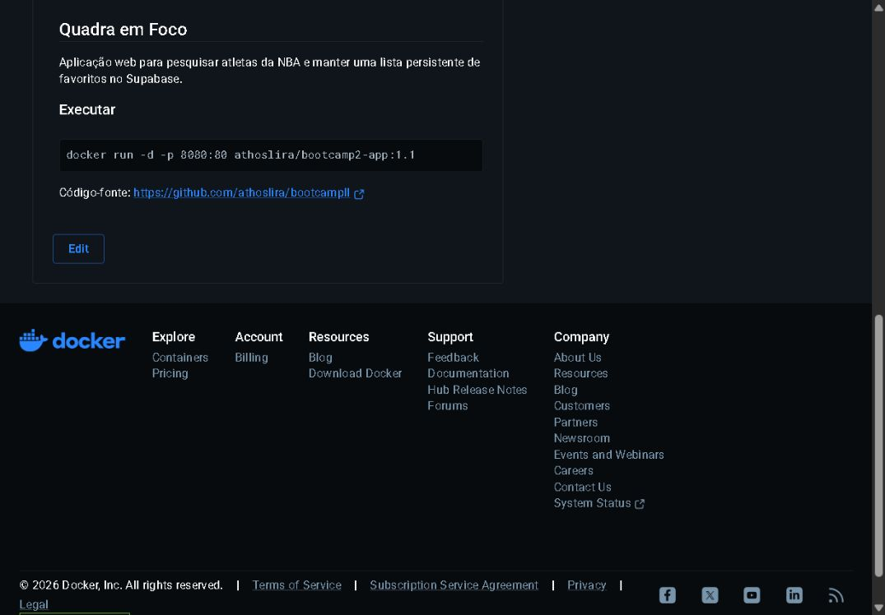
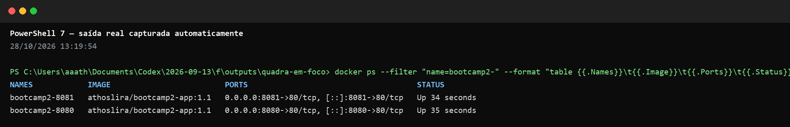

# Quadra em Foco

Aplicação web para pesquisar atletas da NBA, salvar favoritos e comparar dois atletas nas estatísticas da temporada regular 2025–26.

## Autoria e responsabilidade individual

Esta entrega foi realizada individualmente, conforme autorização para realização individual. **Athos Lira Araújo**, matrícula **22307894**, usuário GitHub **athoslira**, é responsável pela implementação, pelos testes, pela integração contínua, pela imagem Docker e pela documentação da etapa 03.

## Links da entrega

- [Repositório no GitHub](https://github.com/athoslira/bootcampII)
- [Pull Request principal da etapa 03 — #1](https://github.com/athoslira/bootcampII/pull/1)
- [Aplicação no GitHub Pages](https://athoslira.github.io/bootcampII/)
- [Imagem no Docker Hub](https://hub.docker.com/r/athoslira/bootcamp2-app)

## Funcionalidades

- Busca por nome completo ou parcial, com foto, equipe, posição, altura, peso e formação.
- Criação, listagem e exclusão de favoritos persistidos no Supabase, com prevenção de duplicatas e indicação de atleta salvo.
- **Duelo de atletas:** selecione até dois resultados da busca, remova uma seleção para substituí-la e compare oito métricas lado a lado.
- Destaque do maior valor de cada métrica e barras proporcionais; empates e dados ausentes não recebem um vencedor.
- Estados de carregamento e erro, operação por teclado e preservação do foco após atualizações do comparador.

O CSV é carregado na primeira seleção para o duelo e reutilizado durante a sessão. Uma falha nessa fonte é informada no comparador e não impede a busca de atletas. O duelo existe apenas na sessão da página; os favoritos continuam persistentes.

## Fontes de dados

Os perfis e as fotos vêm do dataset público [NBA Rosters](https://github.com/A-V29/NBA.Rosters), por meio do [elenco JSON 2025–26](https://raw.githubusercontent.com/A-V29/NBA.Rosters/main/2025-26.NBA.Roster.json).

As estatísticas vêm do repositório público [NBA API 25–26 Data, de EasySportsApps](https://github.com/EasySportsApps/nba_api_25_26_data), no arquivo [nba_players_regular_season_25_26_wide_data.csv](https://raw.githubusercontent.com/EasySportsApps/nba_api_25_26_data/refs/heads/main/nba_players_regular_season_25_26_wide_data.csv). A aplicação consulta as fontes remotas diretamente, por isso depende de conexão e da disponibilidade desses arquivos.

### Cálculos do comparador

O módulo `stats.js` interpreta o CSV, normaliza os nomes sem diferenciar acentos, pontuação e maiúsculas e agrega as linhas com o mesmo nome antes de calcular as métricas. O número de jogos é a soma de `wins + losses`.

| Métrica | Cálculo a partir dos totais agregados |
| --- | --- |
| Pontos/jogo | `(one_point_made + 2 × two_point_made + 3 × three_point_made) / jogos` |
| Rebotes/jogo | `(offensive_rebounds + defensive_rebounds) / jogos` |
| Assistências/jogo | `assists / jogos` |
| Roubos/jogo | `steals / jogos` |
| Bloqueios/jogo | `blocks / jogos` |
| Minutos/jogo | `minutes_played / jogos` |
| Aproveitamento de quadra | `100 × (two_point_made + three_point_made) / (two_point_attempted + three_point_attempted)` |
| Aproveitamento de três | `100 × three_point_made / three_point_attempted` |

Não há média das médias: os totais das linhas são somados primeiro. Registros sem jogos válidos ficam fora do índice; métricas indisponíveis e divisões sem tentativas aparecem como `—`. Um atleta sem correspondência no índice recebe a indicação **Sem dados na temporada**. Os valores são exibidos com uma casa decimal, em formato brasileiro.

## Persistência

Os favoritos são armazenados na tabela PostgreSQL `favoritos` do Supabase. O [script de criação](supabase/schema.sql) define o identificador, a data de cadastro, a chave única de nome e equipe e os campos do perfil do atleta. A aplicação realiza **Create**, **Read** e **Delete**.

O Row Level Security está habilitado com políticas anônimas de leitura, inclusão e exclusão para esta atividade acadêmica. Como não há autenticação, todos os visitantes compartilham a lista de favoritos.

## Executar localmente

Use um servidor HTTP para carregar os módulos JavaScript:

```bash
git clone https://github.com/athoslira/bootcampII.git
cd bootcampII
python -m http.server 8080
```

Abra `http://localhost:8080`, pesquise dois atletas e use **Adicionar ao duelo** em cada resultado.

## Testes e integração contínua

Com Node.js 20 e npm instalados:

```bash
npm ci
npm test
```

O projeto usa o test runner nativo do Node.js e não possui dependências npm externas. O `package-lock.json` é versionado para permitir instalação reproduzível com `npm ci`.

Os testes cobrem perfis e favoritos, interpretação do CSV, normalização de nomes, agregação e cálculos, seleção e remoção no duelo, prevenção de duplicatas, apresentação de métricas, escape de conteúdo remoto, falhas de rede e preservação de foco nas atualizações assíncronas.

O [workflow CI](.github/workflows/ci.yml) executa em pushes para `main` e pull requests destinados a `main`. O job `test` usa Ubuntu, Node.js 20, cache npm, `npm ci` e `npm test`, com permissão somente de leitura do conteúdo do repositório.

Evidência da demonstração de bloqueio por falha no CI: [etapa-03-ci-bloqueado.png](evidencias/etapa-03-ci-bloqueado.png).

## Docker: etapa 03

A versão **2.0** inclui o comparador e seus módulos `stats.js` e `comparison.js`. A imagem usa Nginx Alpine para servir os arquivos estáticos. As tags da entrega são `athoslira/bootcamp2-app:2.0` e `athoslira/bootcamp2-app:latest`; `latest` deve acompanhar a versão 2.0 ao publicar esta etapa.

Para construir localmente as duas tags:

```bash
docker build -t athoslira/bootcamp2-app:2.0 -t athoslira/bootcamp2-app:latest .
```

Para executar a versão 2.0:

```bash
docker run --rm -d --name bootcamp2-v2 -p 8080:80 athoslira/bootcamp2-app:2.0
```

Abra `http://localhost:8080`. Para usar a tag de acompanhamento, substitua `:2.0` por `:latest`. Para encerrar:

```bash
docker stop bootcamp2-v2
```

Após autenticar no Docker Hub, a publicação das tags é feita com:

```bash
docker push athoslira/bootcamp2-app:2.0
docker push athoslira/bootcamp2-app:latest
```

As versões anteriores `1.0` e `1.1` registram, respectivamente, os favoritos persistentes e a melhoria visual de prevenção de duplicatas.

## Conflitos

Não houve conflito de merge nesta entrega individual.

## Sidequests das etapas anteriores

- **SQ1 · Contexto Docker:** o [`.dockerignore`](.dockerignore) exclui histórico Git, testes, evidências, documentação e dependências locais do contexto de build.
- **SQ2 · Versionamento:** as versões podem ser consultadas nas [tags do Docker Hub](https://hub.docker.com/r/athoslira/bootcamp2-app/tags).
- **SQ3 · Overview:** o overview apresenta a aplicação, o comando de execução e o link para o código-fonte.
- **SQ4 · Orquestração:** dois containers da versão 1.1 foram executados nas portas 8080 e 8081. Para uma implantação com 100 containers, um Deployment no Kubernetes permitiria declarar réplicas e substituir instâncias que falham; cada pod encapsularia uma instância da aplicação dentro do cluster.





## Limitações conhecidas

- Os favoritos são compartilhados porque a aplicação não possui autenticação.
- Perfis e estatísticas são fontes distintas, associadas pelo nome normalizado; diferenças de grafia podem deixar atletas sem estatísticas no duelo.
- A disponibilidade das fotos e dos dados depende das fontes externas.
